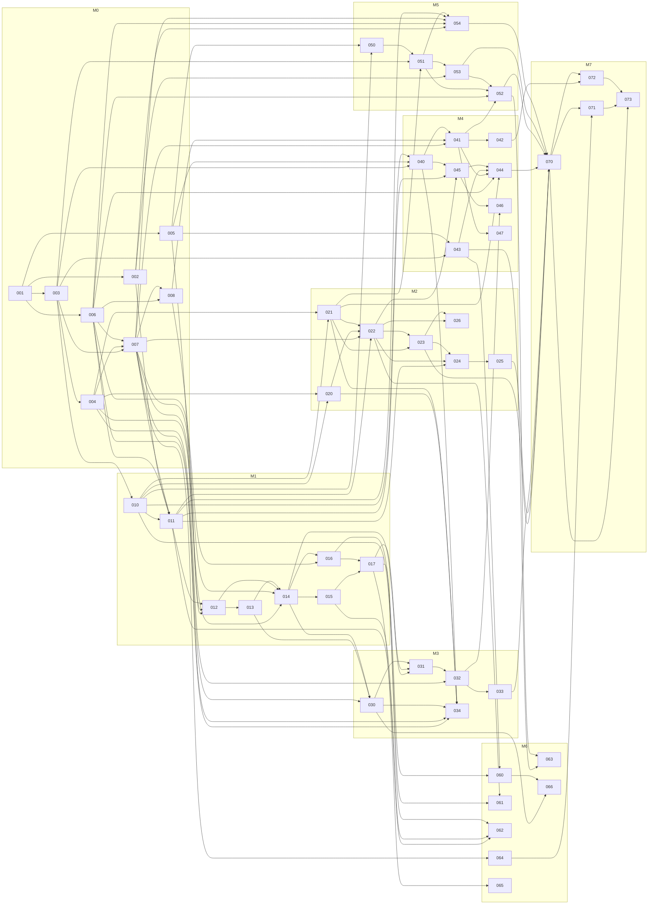

# Implementation tickets

Status: **Ready for implementation — owner acknowledgements A1–A9 recorded** ([REVIEW.md](../REVIEW.md)) · 2026-10-11

Source documents: [SPEC.md](../SPEC.md) · [DESIGN.md](../DESIGN.md) · review record and owner
acknowledgements: [REVIEW.md](../REVIEW.md)

## Conventions

| Field         | Meaning                                                                                 |
| ------------- | --------------------------------------------------------------------------------------- |
| ID            | `SE-0xx`; the tens digit is the milestone                                               |
| Size          | S ≤ 1 day · M 2–3 days · L 4–6 days (one developer)                                     |
| Status        | Draft → Ready → In progress → Done. **Ready** means specified and independently reviewed; it does not waive the start conditions below |
| Depends on    | Tickets that must be **Done** before this one starts                                    |
| Blocks        | Exact inverse of "Depends on"                                                           |
| Blocked until | Blocking criteria beyond ticket dependencies: a gate, or an owner acknowledgement recorded in REVIEW.md |
| Acceptance    | Testable conditions; all must hold for Done, plus the definition of done in SPEC §11    |

A ticket may start only when every dependency is Done **and** its "Blocked until" condition holds.

## Gates

| Gate | Condition (checkable)                                                                              | Set by  | Blocks                         | State   |
| ---- | -------------------------------------------------------------------------------------------------- | ------- | ------------------------------ | ------- |
| G0   | Engine feasibility: every SE-002 question meets its go threshold, or SPEC §6/§9 is amended with the fallback and the amendment is recorded in REVIEW.md | SE-002 | SE-011, SE-053, SE-054 | Passed 2026-10-12 |
| G1   | Drawing loop: SE-015 and SE-017 Done, including the recorded stroke latency budget (with or without the echo fallback) | SE-017 | SE-022, SE-041, SE-054 | Passed 2026-10-15 |
| G2   | Export conformance: the three conditions of SPEC §9.7 pass locally and in CI                       | SE-053  | SE-052, SE-070 (as dependencies) | Passed 2026-10-14 |
| G3   | Release readiness: every v1 ticket other than SE-073 is Done, or descoped by the owner in writing in REVIEW.md. `.ngsprite` v1 and `ngne-sprite-atlas` v1 are frozen at this point | — | SE-073 | Pending |

Why G1 gates interface work that does not technically depend on drawing: the stroke latency
result can change the viewport design (SPEC §6.6). Building the timeline, file workflows and
preview on top of it before that is settled risks rework.

Owner acknowledgements (SPEC §12) are start conditions, not gates: A1, A4, A5, A6, A8 before
SE-001; A9 before SE-002; A7 before SE-003; A3 before SE-043; A2 before SE-050.

## Ticket index

Dependencies are listed without the `SE-` prefix; "Blocked until" is abbreviated (A = owner acknowledgement recorded in REVIEW.md, G = gate passed).

| ID     | Title                                             | Size | Depends on                         | Blocked until | Status |
| ------ | ------------------------------------------------- | ---- | ---------------------------------- | ------------- | ------ |
| **M0** | **[Foundation](M0-foundation.md)**                |      |                                    |               |        |
| SE-001 | Repository, scaffold, toolchain and CI            | L    | —                                  | A1, A4, A5, A6, A8 | Done  |
| SE-002 | Spike: NGNE integration feasibility (gate G0)     | L    | 001                                | A9            | Done   |
| SE-003 | Document model and session                        | M    | 001                                | A7            | Done   |
| SE-004 | Commands, transactions and undo history           | L    | 003                                | —             | Done   |
| SE-005 | Pixel buffers and lossless PNG codec              | M    | 001                                | —             | Done   |
| SE-006 | Design tokens, UI primitives and app shell        | L    | 001                                | —             | Done   |
| SE-007 | Editor state, command registry, keymap, menus and preference store | L | 003, 004, 006         | —             | Done   |
| SE-008 | New sprite, sprite properties and empty state     | M    | 006, 007                           | —             | Done   |
| **M1** | **[Viewport and drawing](M1-viewport-and-drawing.md)** |  |                                  |               |        |
| SE-010 | CPU compositor                                    | M    | 003                                | —             | Done   |
| SE-011 | NgneViewport                                      | L    | 002, 006, 007, 010                 | G0            | Done   |
| SE-012 | View navigation and coordinate mapping            | M    | 007, 008, 011                      | —             | Done   |
| SE-013 | Overlay canvas                                    | M    | 012                                | —             | Done   |
| SE-014 | Tool framework and pointer pipeline               | L    | 004, 007, 012, 013                 | —             | Done   |
| SE-015 | Pencil and eraser                                 | L    | 014                                | —             | Done   |
| SE-016 | Colour state, picker and eyedropper               | M    | 006, 014                           | —             | Done   |
| SE-017 | Bucket, line, rectangle and ellipse (gate G1)     | M    | 015, 016                           | —             | Done   |
| **M2** | **[Layers and timeline](M2-layers-and-timeline.md)** |   |                                    |               |        |
| SE-020 | Layer commands                                    | M    | 004, 010                           | —             | Done   |
| SE-021 | Frame, cel and tag commands                       | L    | 004, 010                           | —             | Done   |
| SE-022 | Timeline panel                                    | L    | 007, 011, 020, 021                 | G1            | In progress |
| SE-023 | Tags UI                                           | M    | 021, 022                           | —             | Ready  |
| SE-024 | Editor playback                                   | M    | 011, 022, 023                      | —             | Ready  |
| SE-025 | Onion skin                                        | M    | 024                                | —             | Ready  |
| SE-026 | Timeline editing interactions                     | M    | 022, 023                           | —             | Ready  |
| **M3** | **[Selection and transform](M3-selection-and-transform.md)** | |                                |               |        |
| SE-030 | Selection model and marching ants                 | M    | 004, 013, 014                      | —             | Done   |
| SE-031 | Selection tools                                   | M    | 014, 017, 030                      | —             | In progress |
| SE-032 | Move, floating selection and clipboard            | L    | 005, 031                           | —             | Ready  |
| SE-033 | Selection transforms                              | M    | 032                                | —             | Ready  |
| SE-034 | Sprite operations                                 | L    | 006, 007, 020, 021, 030, 040       | —             | Done   |
| **M4** | **[Persistence and import](M4-persistence-and-import.md)** | |                                  |               |        |
| SE-040 | Project file format (`.ngsprite`)                 | M    | 003, 005, 010                      | —             | Done   |
| SE-041 | File workflows                                    | L    | 007, 008, 040                      | G1            | In progress |
| SE-042 | Autosave and crash recovery                       | M    | 041                                | —             | Ready  |
| SE-043 | Import pipeline core and preset palettes          | L    | 003, 005                           | A3            | Done   |
| SE-044 | Import PNG dialog                                 | L    | 006, 021, 041, 043, 045            | —             | Ready  |
| SE-045 | Reference layers                                  | L    | 011, 022, 040                      | —             | Ready  |
| SE-046 | Reference layer move and scale on the canvas      | M    | 032, 045                           | —             | Ready  |
| SE-047 | Document tabs and recent files                    | M    | 041                                | —             | Ready  |
| **M5** | **[NGNE export](M5-ngne-export.md)**              |      |                                    |               |        |
| SE-050 | Atlas packer                                      | M    | 005, 010                           | A2            | Done   |
| SE-051 | NGNE bundle writers                               | L    | 003, 021, 050                      | —             | Done   |
| SE-052 | Export dialog and delivery                        | L    | 006, 041, 051, 053                 | —             | Ready  |
| SE-053 | Export conformance against NGNE (gate G2)         | L    | 002, 051                           | G0            | Done   |
| SE-054 | Preview panel (NGNE `BrowserGame`)                | L    | 002, 006, 007, 011, 051            | G0, G1        | Ready  |
| **M6** | **[Palette and parity extras](M6-palette-and-parity.md)** | |                                   |               |        |
| SE-060 | Palette panel                                     | M    | 016, 043                           | —             | Done   |
| SE-061 | Blend modes and cel opacity                       | M    | 010, 022                           | —             | Ready  |
| SE-062 | Symmetry and tiled mode                           | M    | 011, 015, 017                      | —             | Ready  |
| SE-063 | GIF export                                        | M    | 043, 052                           | —             | Ready  |
| SE-064 | Preferences dialog, command palette and shortcut sheet | M | 007                              | —             | Done   |
| SE-065 | Tools II: curve, contour, polygon, spray          | M    | 017                                | —             | Ready  |
| SE-066 | Palette files, replace colour and sort            | M    | 030, 060                           | —             | Ready  |
| **M7** | **[Hardening and release](M7-hardening-and-release.md)** | |                                    |               |        |
| SE-070 | End-to-end regression suite and performance record | L   | 023, 025, 033, 044, 052, 053, 054  | —             | Ready  |
| SE-071 | Accessibility and interface audit                 | M    | 064, 070                           | —             | Ready  |
| SE-072 | Installable PWA and offline use                   | M    | 042, 070                           | —             | Ready  |
| SE-073 | Documentation and release (gate G3)               | M    | 070, 071, 072                      | G3            | Ready  |

52 tickets: 31 M, 21 L; 122 dependency edges. From the size ranges: 146–219 developer-days for
one developer. Tickets outside SE-073's dependency closure (026, 034, 046, 047, 060, 061, 062,
063, 065, 066) are still required for release by gate G3.

## Constraint traceability

| Requirement                                  | Tickets                                         | Verified by                    |
| -------------------------------------------- | ----------------------------------------------- | ------------------------------ |
| Uses NGNE behind the scenes                  | SE-002, SE-011, SE-024, SE-025, SE-045, SE-054  | SE-011, SE-054 acceptance      |
| C1 Save/export NGNE-ready assets             | SE-040, SE-041, SE-050, SE-051, SE-052, SE-053  | SE-053 (gate G2)               |
| C2 Import PNG, quantize to sprites at a size | SE-005, SE-043, SE-044                          | SE-043, SE-044 acceptance      |
| C3 Reference PNG behind the canvas           | SE-045, SE-044, SE-046                          | SE-045 acceptance              |
| Frame animation                              | SE-021, SE-022, SE-023, SE-024, SE-025, SE-054  | SE-024, SE-054 acceptance      |
| Layering                                     | SE-010, SE-020, SE-022, SE-026, SE-061          | SE-020, SE-061 acceptance      |
| Minimal, professional interface              | SE-006, SE-071                                  | SE-071 audit                   |
| Aseprite parity tiers (SPEC §2.3)            | all M1–M6 tickets                               | Gate G3                        |

## Parallel work

Wave order, runs and rules for implementing with several agents at once:
[EXECUTION.md](EXECUTION.md).

After SE-001 three people can start at once; the tracks merge early.

| Track       | Starts with                          | First merge point                         |
| ----------- | ------------------------------------ | ----------------------------------------- |
| Core        | 003 → 004, 010; 005                  | SE-007 (needs 003, 004 and 006)           |
| Engine      | 002 (spike, gate G0)                 | SE-011 (needs 002, 006, 007, 010)         |
| Interface   | 006                                  | SE-007, then SE-008                       |

Core-only tickets with no interface or engine dependency can proceed at any time once their
dependencies are Done: 020, 021, 040, 043, 050, 051.

Longest dependency chain to a drawable canvas (G1):
`001 → 003 → 004 → 007 → 011 → 012 → 013 → 014 → 015 → 017`.

Longest chain to NGNE export conformance (G2): `001 → 003 → 004 → 021 → 051 → 053`
(with `005, 010 → 050` and `002` feeding in). It needs no interface ticket.

Longest chain to release: the G1 chain, then `031 → 032 → 033 → 070 → 071 → 073`.

## Dependency graph

Mermaid; renders in GitHub and in the VS Code Markdown preview (with Mermaid support), not in a
terminal. Generated from the ticket files; node labels are ticket numbers.

## Suggested order for one developer

1. M0: 001, 002, 003, 005, 004, 006, 007, 008 → **G0**
2. M1: 010, 011, 012, 013, 014, 015, 016, 017 → **G1**
3. M2: 020, 021, 022, 023, 024, 025, 026
4. M5 core: 050, 051, 053 → **G2**
5. M4: 040, 041, 042, 047, 043, 045, 044
6. M5 rest: 052, 054
7. M3: 030, 031, 032, 033, 034, 046
8. M6: 060, 066, 061, 062, 063, 064, 065
9. M7: 070, 071, 072, 073 → **G3**

Milestone numbers group related work; they are not a strict sequence. Dependencies, gates and
owner acknowledgements are the only ordering constraints. This order was checked mechanically
against the "Depends on" fields.
