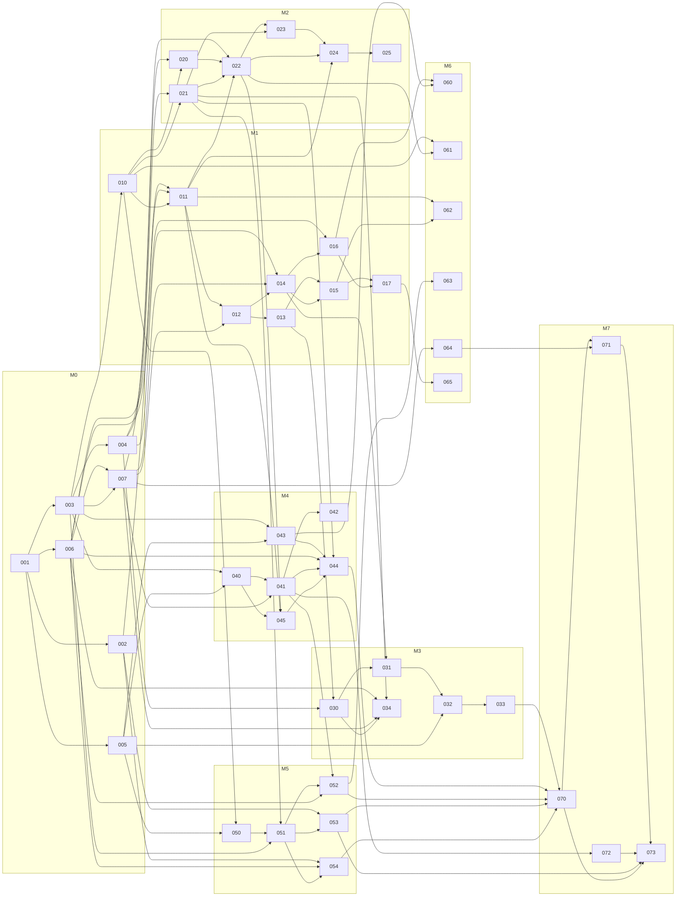

# Implementation tickets

Status: **Draft — pending independent review** · 2026-10-11

Source documents: [SPEC.md](../SPEC.md) · [DESIGN.md](../DESIGN.md) · review record: [REVIEW.md](../REVIEW.md)

## Conventions

| Field         | Meaning                                                                                 |
| ------------- | --------------------------------------------------------------------------------------- |
| ID            | `SE-0xx`; the tens digit is the milestone                                               |
| Size          | S ≤ 1 day · M 2–3 days · L 4–6 days (one developer)                                     |
| Status        | Draft → Ready → In progress → Done                                                      |
| Depends on    | Tickets that must be **Done** before this one starts                                    |
| Blocks        | Inverse of "Depends on"                                                                 |
| Blocked until | Blocking criteria beyond ticket dependencies: a gate or an owner decision               |
| Acceptance    | Testable conditions; all must hold for Done, plus the definition of done in SPEC §11    |

A ticket may start only when every dependency is Done **and** its "Blocked until" condition holds.

## Gates

| Gate | Condition                                                                                          | Set by  | Blocks                         | State   |
| ---- | -------------------------------------------------------------------------------------------------- | ------- | ------------------------------ | ------- |
| G0   | Engine feasibility: every SE-002 question is "go", or SPEC §6 is amended and re-reviewed           | SE-002  | SE-011, SE-053, SE-054         | Pending |
| G1   | Toolchain: `npm run check` green, including the WebGPU smoke test                                  | SE-001  | Everything                     | Pending |
| G2   | Drawing loop: SE-015 and SE-017 accepted, including the stroke latency budget or its fallback      | SE-017  | SE-022, SE-031                 | Pending |
| G3   | Format freeze: `.ngsprite` v1 (SE-040) and `ngne-sprite-atlas` v1 (SE-051) merged; changes need a version bump and migration | SE-040, SE-051 | SE-052 | Pending |
| G4   | Export conformance: SPEC §9.7 passes (SE-053)                                                      | SE-053  | SE-070, SE-073                 | Pending |

Owner decisions (SPEC §12): assumptions A1–A7 are adopted. Each lists the ticket before which it
can still be overridden without rework.

## Ticket index

| ID     | Title                                             | Size | Depends on                         | Blocked until | Status |
| ------ | ------------------------------------------------- | ---- | ---------------------------------- | ------------- | ------ |
| **M0** | **[Foundation](M0-foundation.md)**                |      |                                    |               |        |
| SE-001 | Project scaffold and toolchain                    | M    | —                                  | A1, A4–A6     | Draft  |
| SE-002 | Spike: NGNE viewport feasibility                  | M    | 001                                | —             | Draft  |
| SE-003 | Document model                                    | M    | 001                                | —             | Draft  |
| SE-004 | Commands, transactions and undo history           | L    | 003                                | —             | Draft  |
| SE-005 | Pixel buffers and lossless PNG codec              | M    | 001                                | —             | Draft  |
| SE-006 | Design tokens, UI primitives and app shell        | L    | 001                                | —             | Draft  |
| SE-007 | Editor state, command registry, keymap and menus  | L    | 003, 006                           | —             | Draft  |
| **M1** | **[Viewport and drawing](M1-viewport-and-drawing.md)** |  |                                  |               |        |
| SE-010 | CPU compositor                                    | M    | 003                                | —             | Draft  |
| SE-011 | NgneViewport                                      | L    | 002, 006, 010                      | G0            | Draft  |
| SE-012 | View navigation and coordinate mapping            | M    | 007, 011                           | —             | Draft  |
| SE-013 | Overlay canvas                                    | M    | 012                                | —             | Draft  |
| SE-014 | Tool framework and pointer pipeline               | M    | 004, 007, 012                      | —             | Draft  |
| SE-015 | Pencil and eraser                                 | M    | 013, 014                           | —             | Draft  |
| SE-016 | Colour state, picker and eyedropper               | M    | 006, 014                           | —             | Draft  |
| SE-017 | Bucket, line, rectangle and ellipse               | M    | 015, 016                           | —             | Draft  |
| **M2** | **[Layers and timeline](M2-layers-and-timeline.md)** |   |                                    |               |        |
| SE-020 | Layer commands                                    | M    | 004, 010                           | —             | Draft  |
| SE-021 | Frame, cel and tag commands                       | M    | 004, 010                           | —             | Draft  |
| SE-022 | Timeline panel                                    | L    | 007, 011, 020, 021                 | G2            | Draft  |
| SE-023 | Tags UI                                           | S    | 021, 022                           | —             | Draft  |
| SE-024 | Editor playback                                   | M    | 011, 022, 023                      | —             | Draft  |
| SE-025 | Onion skin                                        | M    | 024                                | —             | Draft  |
| **M3** | **[Selection and transform](M3-selection-and-transform.md)** | |                                |               |        |
| SE-030 | Selection model and marching ants                 | M    | 004, 013                           | —             | Draft  |
| SE-031 | Selection tools                                   | M    | 014, 030                           | G2            | Draft  |
| SE-032 | Move, floating selection and clipboard            | L    | 005, 031                           | —             | Draft  |
| SE-033 | Selection transforms                              | M    | 032                                | —             | Draft  |
| SE-034 | Sprite operations                                 | M    | 006, 007, 021, 030                 | —             | Draft  |
| **M4** | **[Persistence and import](M4-persistence-and-import.md)** | |                                  |               |        |
| SE-040 | Project file format (`.ngsprite`)                 | M    | 003, 005                           | —             | Draft  |
| SE-041 | File workflows and document tabs                  | L    | 007, 040                           | —             | Draft  |
| SE-042 | Autosave and crash recovery                       | M    | 041                                | —             | Draft  |
| SE-043 | Import pipeline core (slice, resample, quantize)  | L    | 003, 005                           | A3            | Draft  |
| SE-044 | Import PNG dialog                                 | L    | 006, 021, 041, 043, 045            | —             | Draft  |
| SE-045 | Reference layers                                  | L    | 011, 022, 040                      | A7            | Draft  |
| **M5** | **[NGNE export](M5-ngne-export.md)**              |      |                                    |               |        |
| SE-050 | Atlas packer                                      | M    | 005, 010                           | —             | Draft  |
| SE-051 | NGNE bundle writers                               | L    | 003, 021, 050                      | A2            | Draft  |
| SE-052 | Export dialog and delivery                        | L    | 006, 041, 051                      | G3            | Draft  |
| SE-053 | Export conformance against NGNE                   | M    | 002, 051                           | G0            | Draft  |
| SE-054 | Preview panel (NGNE `BrowserGame`)                | L    | 002, 006, 051                      | G0            | Draft  |
| **M6** | **[Palette and parity extras](M6-palette-and-parity.md)** | |                                   |               |        |
| SE-060 | Palette panel                                     | L    | 016, 043                           | —             | Draft  |
| SE-061 | Blend modes and cel opacity                       | M    | 010, 022                           | —             | Draft  |
| SE-062 | Symmetry and tiled mode                           | M    | 011, 015                           | —             | Draft  |
| SE-063 | Compatibility exports: Aseprite JSON and GIF      | M    | 052                                | —             | Draft  |
| SE-064 | Preferences, command palette and shortcut sheet   | M    | 007                                | —             | Draft  |
| SE-065 | Tools II: curve, contour, polygon, spray          | M    | 017                                | —             | Draft  |
| **M7** | **[Hardening and release](M7-hardening-and-release.md)** | |                                    |               |        |
| SE-070 | End-to-end regression suite and performance record | L   | 033, 044, 052, 053, 054            | G4            | Draft  |
| SE-071 | Accessibility and interface audit                 | M    | 064, 070                           | —             | Draft  |
| SE-072 | Installable PWA and offline use                   | M    | 041                                | —             | Draft  |
| SE-073 | Documentation and release                         | M    | 053, 070, 071, 072                 | G4            | Draft  |

47 tickets: 1 S, 31 M, 15 L. Rough total 150–160 developer-days for one developer; the three
tracks below allow two to three people to work in parallel after SE-001.

## Constraint traceability

| Constraint                                   | Tickets                                         | Verified by                    |
| -------------------------------------------- | ----------------------------------------------- | ------------------------------ |
| Uses NGNE behind the scenes                  | SE-002, SE-011, SE-025, SE-045, SE-054          | SE-011, SE-054 acceptance      |
| C1 Save/export NGNE-ready assets             | SE-040, SE-041, SE-050, SE-051, SE-052, SE-053  | SE-053 (gate G4)               |
| C2 Import PNG, quantize to sprites at a size | SE-005, SE-043, SE-044                          | SE-043, SE-044 acceptance      |
| C3 Reference PNG behind the canvas           | SE-045, SE-044                                  | SE-045 acceptance              |
| Frame animation                              | SE-021, SE-022, SE-023, SE-024, SE-025, SE-054  | SE-024, SE-054 acceptance      |
| Layering                                     | SE-010, SE-020, SE-022, SE-061                  | SE-020, SE-061 acceptance      |
| Minimal, professional interface              | SE-006, SE-071                                  | SE-071 audit                   |

## Parallel tracks

After SE-001, three tracks have no mutual dependencies until the join points:

| Track       | Tickets in order                                             | Joins at               |
| ----------- | ------------------------------------------------------------ | ---------------------- |
| Core        | 003 → 004 → 010 → 020, 021 → 050 → 051; 005 → 040, 043       | SE-011, SE-022, SE-041 |
| Engine      | 002 → (G0) → 011 → 012 → 013                                 | SE-014, SE-015         |
| Interface   | 006 → 007 → 064                                              | SE-012, SE-014, SE-022 |

Critical path to a drawable canvas (G2):
`001 → 003 → 004 → 014 → 015 → 017`, with `002 → 011 → 012` and `006 → 007` feeding SE-014.

Critical path to NGNE export (G4):
`001 → 003 → 004 → 021 → 051 → 053`, with `005/010 → 050` feeding SE-051 and `002` feeding SE-053.
The export core does not wait for any interface ticket.

## Dependency graph

Mermaid; renders in GitHub and in the VS Code Markdown preview (with Mermaid support), not in a
terminal.

## Suggested order for one developer

1. M0: 001, 002, 003, 005, 004, 006, 007
2. M1: 010, 011, 012, 013, 014, 015, 016, 017 → **G2**
3. M2: 020, 021, 022, 023, 024, 025
4. M5 core early: 050, 051 → **G3 (atlas)**; then 053 → **G4**
5. M4: 040, 041, 042, 043, 045, 044
6. M5 rest: 052, 054
7. M3: 030, 031, 032, 033, 034
8. M6 in any order; M7: 070, 072, 071, 073

Milestone numbers group related work; they are not a strict sequence. Dependencies and gates are
the only ordering constraints.
